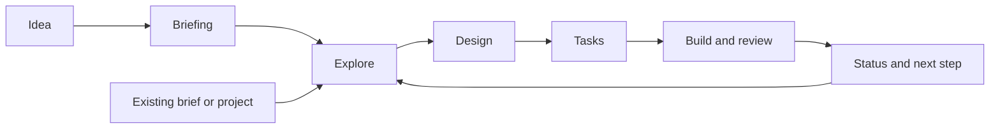

# Tequio

**Give your coding agent a workflow—from rough idea to tested, reviewed implementation.**

Tequio (TEH-kyoh) helps you build software with your coding agent, keeping the brief, plan, tasks, checks and reviews connected as work moves across sessions. Your agent does the engineering. Tequio supplies reusable instructions and a local CLI that records the work and guards task transitions.

Version 0.18.0. **Early release · MIT**

A Katalytics Labs project, created and maintained by Victor Flores Terrazas.

The name comes from *tequio*, a tradition of work for the community, derived from the Nahuatl *tequitl*. [About the word](https://www.nacionmulticultural.unam.mx/100preguntas/pregunta.php?num_pre=24).



For example, “archived items keep showing in my task list” becomes a reproduced bug, a bounded correction, checks for the intended behavior and an independent review. You can inspect what passed and what still needs attention. A completed task does not automatically mean the whole product is ready to ship.

[Install](#install) · [First steps](#start-with-your-agent) · [Windows / WSL](docs/windows-wsl.md) · [Walkthrough](docs/getting-started.md) · [Documentation](#documentation)

## Before you install

You need **Python 3.11+**, a project folder you want to work in, and a coding agent that can read local files and run commands with your permission. Tequio’s runtime uses the Python standard library; it does not need additional Python packages. Git is needed for the clone instructions.

| Environment | Current status |
| --- | --- |
| macOS | Tested; current release checks use Python 3.14.5 |
| Linux | Not yet qualified |
| Native Windows, including Git Bash with Windows Python | Unsupported: the CLI needs POSIX file locking and process controls |
| Windows with WSL 2 | **Experimental setup route**, not yet tested with Tequio on Windows |

Windows users: read the [guided WSL setup](docs/windows-wsl.md) before running the installer. Your agent can help with setup, but administrator approval, restarting Windows and signing in may need your attention.

The installer places skills in `.agents/skills/`. Discovery and delegation vary by harness. Codex CLI has bounded macOS observations; Claude Code and Antigravity setups should verify their actual file/tool access rather than assume automatic discovery. If a skill does not appear, ask the agent to read its installed `SKILL.md` directly. [Compatibility and evidence](docs/compatibility.md).

## Install

### Ask your agent

Open your intended project in your coding agent and paste:

```text
Install Tequio from https://github.com/katalytics-labs/tequio into this project.
Read its README and installation guide first. Before running its CLI, check the
operating system, whether this session is inside WSL, and the Python requirements.
On native Windows, explain the limitation and offer the documented experimental
WSL route; do not port Tequio or install system components without asking me.

Confirm the target project if it is unclear. Keep the Tequio source copy separate
from my project. Preserve existing files and global agent configuration; stop on
collisions or modified installer-owned files rather than overwriting them.
Install only into the selected project and verify installation health. Do not
start implementation, commit, push or deploy. Explain what was installed, any
missing requirements, and how to reopen the correct project/agent environment.
```

Your agent needs local command access. It may need you to approve commands or complete sign-in. If it cannot run commands, use the manual instructions or ask it to walk you through them.

### Run the commands yourself

Run these in a macOS terminal or your Linux/WSL environment. The target project folder must already exist. Replace the quoted example path with its actual absolute path; install into your project, not the Tequio source folder.

```sh
git clone https://github.com/katalytics-labs/tequio.git
cd tequio
python3 --version
python3 bin/tequio install "/absolute/path/to/your-project"
```

Then, **from your project folder**:

```sh
cd "/absolute/path/to/your-project"
python3 bin/tequio doctor --installation-only
```

Inspect the reported installation health; successful command execution alone does not mean every asset is intact. Start a fresh agent session in that project so it can discover the skills.

Prefer a ZIP? Download the repository using GitHub’s **Code → Download ZIP**, extract it, open a terminal in the extracted source folder, and run the same `python3 bin/tequio install ...` command. Keep the complete folder, including `src/`, `skills/`, templates and `bundle.json` together. Homebrew and npm/`npx` distribution are future options, not currently supported install commands.

[Detailed setup, updates and uninstall](docs/getting-started.md).

## Start with your agent

### “I have an idea”

```text
Use Tequio to help me shape an idea into a concise product brief. Ask a few
focused questions about the people, problem, main use case and constraints;
leave smaller details and research questions open. Don't start implementation.
My idea is: [describe it here].

If the skill is not discovered, read
.tequio/skills/tequio-briefing/SKILL.md in this project and follow it.
```

### “I already have a brief or project”

```text
Use Tequio Explore to inspect this project and my brief, reuse existing research,
and investigate the important gaps. Keep requirements, evidence and uncertainties
clear. Propose a bounded next step; don't start implementation yet.
My brief or requested change is: [paste it or give its file path].

If the skill is not discovered, read
.tequio/skills/tequio-explore/SKILL.md in this project and follow it.
```

The everyday flow is **Explore → Design → Tasks → Build**, with optional Briefing first. Say “use Tequio Design,” “use Tequio Tasks,” or “use Tequio Build” when ready for that step. Tasks are reviewed before import; Build includes checks, documentation and independent implementation review. If the host cannot provide a genuine separate reviewer, work stays review-pending.

Ask **“Use Tequio Status: what works, what remains, and what should I do next?”** whenever you lose your place. If needed, point the agent to `.tequio/skills/tequio-status/SKILL.md`. Larger projects get a compact milestone docket with honest remaining acceptance. “Brief status” and “next action only” stay short. Some harnesses expose skills with `$`, others with `/`; names and file-reading prompts are useful when discovery differs.

Want a small practice project first? Follow the [archive-filter walkthrough](docs/getting-started.md#try-one-small-change). It uses ordinary Python files, needs no application service accounts, and keeps the exercise separate from your product.

## What lives in your project

Installation adds a local launcher (`bin/tequio`), skill discovery files (`.agents/skills/tequio-*`), and a private `.tequio/` directory for the runtime, workspace state, reviews and evidence. It adds a marked block to `.gitignore`. Existing project instructions and global agent settings are preserved; conflicting files cause a refusal.

Keep task records, prompts, credentials and session evidence private. Ignore rules do not erase already tracked files or Git history. Tequio has no model service or telemetry of its own; your agent may send project content to its provider according to its settings. **Project-local does not mean all agent work stays on your machine.**

## What to expect

Tequio is useful when a change outgrows one conversation and you need a traceable plan, bounded work and a reliable handoff. Reviews and verification take time; a tiny throwaway edit may not need the full workflow.

The CLI checks declared dependencies, ownership conflicts, input freshness, check receipts and review records. Agents remain responsible for interpreting requirements, testing meaningful behavior and arranging genuine independent review. Local actor names are not authenticated identities. Tequio is not a command sandbox, a background agent service or a guarantee of production readiness. [Validation and limits](docs/validation.md).

## Update or uninstall

Projects keep standalone snapshots. Updating your Tequio source copy does **not** silently upgrade every project. Choose one action below and run it from the source copy.

**Update one project**, after reviewing the release:

```sh
python3 bin/tequio install "/absolute/path/to/your-project"
```

**Or uninstall** its installer-owned assets:

```sh
python3 bin/tequio uninstall "/absolute/path/to/your-project"
```

 Modified owned files cause a refusal so they can be reconciled first. Uninstall retains workspace evidence, project-owned specialists and private ignore protections. Start a fresh agent session after an update. [Full instructions](docs/getting-started.md#update-or-uninstall).

## Documentation

[First steps](docs/getting-started.md) · [Windows / WSL](docs/windows-wsl.md) · [All skills](docs/skill-reference.md) · [Operator guide](docs/operator-guide.md) · [Architecture](docs/architecture.md) · [Specialist factory](docs/specialist-factory.md) · [Prerequisite recovery](docs/prerequisite-recovery.md) · [Compatibility](docs/compatibility.md)

For a deterministic local demonstration, run `python3 examples/quickstart/run_demo.py` from the source copy. It runs real checks on pre-authored example code and intentionally stops pending independent review. It uses no model or API key; it is not evidence of agent reasoning or productivity. [Example details](examples/quickstart/README.md).

[Contributing](CONTRIBUTING.md) · [MIT license](LICENSE)
